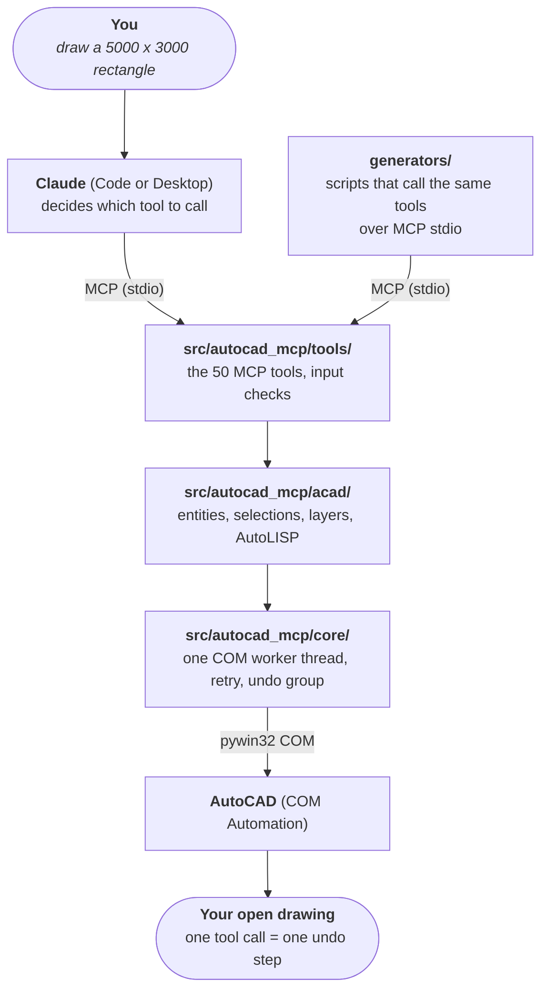

# Project map

**The fastest orientation in this repository**: which folder owns what, where a change starts, and
which source wins when two disagree. For *which document covers what*, use [README.md](README.md).

---

## A. How a request travels

## B. Folders

| Folder | Owns | Start a change at |
|---|---|---|
| [`src/autocad_mcp/`](../src/autocad_mcp/README.md) | The server | `tools/<subject>.py` for a tool, `server.py` for the command line |
| [`generators/`](../generators/README.md) | Drawing-package scripts | The package's `*_run.py` runner |
| [`drawings/`](../drawings/README.md) | Generated DWG / PDF / PNG, **local only, not in git** | Never edit by hand; re-run the generator |
| [`tools/`](../tools/README.md) | Smoke test, protocol check | |
| [`tests/`](../tests/README.md) | Offline and live tests | `test_offline.py` |
| [`docs/`](README.md) | All documentation | This file |
| [`examples/`](../examples/README.md) | Claude Desktop config | |
| [`archive/`](../archive/README.md) | Stopped experiments, kept for reference | Do not build on it |
| `.github/` | CI, issue and pull-request templates | `workflows/ci.yml` |

## C. Entry points

| What | Command |
|---|---|
| Run the server (stdio, as Claude does) | `.venv\Scripts\autocad-mcp.exe` |
| List tools without AutoCAD | `.venv\Scripts\autocad-mcp.exe --list-tools` |
| Server over HTTP | `.venv\Scripts\autocad-mcp.exe --transport http --port 8000` |
| Live smoke test | `.venv\Scripts\python.exe tools/smoke_test.py` |
| MCP handshake check | `.venv\Scripts\python.exe tools/protocol_check.py` |
| Offline tests | `.venv\Scripts\python.exe -m pytest -m "not live"` |
| CCTV package | `python generators/cctv_run.py ...` ([04](04-drawing-generators.md)) |
| AHU package | `python generators/ahu_run.py` / `sheet_run.py` ([04](04-drawing-generators.md)) |

## D. Configuration files

| File | For |
|---|---|
| [`.mcp.json`](../.mcp.json) | Claude Code: registers the `autocad` server when opened in this folder |
| [`.codex/config.toml`](../.codex/config.toml) | Codex: the same server |
| [`examples/claude_desktop_config.json`](../examples/claude_desktop_config.json) | Claude Desktop |
| [`pyproject.toml`](../pyproject.toml) | Package, dependencies, pytest and ruff settings |
| [`generators/paths.py`](../generators/paths.py) | Every folder a generator writes to |

All three MCP configs hold the absolute path of `.venv\Scripts\autocad-mcp.exe`. If the repository
moves, change all three.

## E. Which source wins

1. **The code and the tool output.** `--list-tools` beats any table in these docs.
2. **The tests.** A passing test pins behaviour; a doc that disagrees is wrong.
3. [DECISIONS.md](DECISIONS.md) for *why*.
4. The numbered docs.
5. [HANDOVER.md](HANDOVER.md) last: it is a work note.
